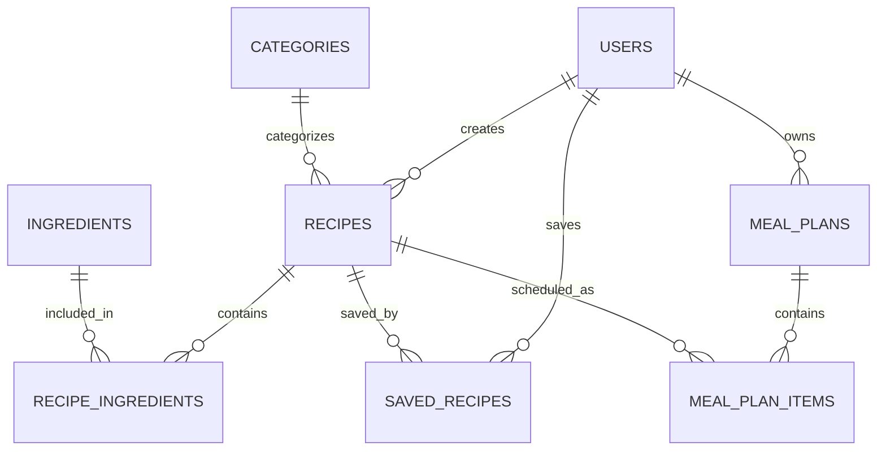

# RecipeHub — Entity Relationship Diagram (ERD)

## 1. Overview

RecipeHub is a recipe-sharing and meal-planning platform. Users can discover recipes, save their favorite recipes, and organize meals into a weekly plan.

## 2. Database Entities

### Users
Stores information about registered users.

- `id` — Primary Key
- `name`
- `email` — Unique
- `password`
- `role` — user or admin
- `created_at`

### Recipes
Stores recipes created and shared on the platform.

- `id` — Primary Key
- `user_id` — Foreign Key referencing Users
- `category_id` — Foreign Key referencing Categories
- `title`
- `description`
- `instructions`
- `difficulty`
- `prep_time`
- `created_at`

### Categories
Stores recipe categories.

- `id` — Primary Key
- `name`

### Ingredients
Stores ingredients that can be used in multiple recipes.

- `id` — Primary Key
- `name`

### Recipe_Ingredients
Connects recipes with their ingredients.

- `recipe_id` — Foreign Key referencing Recipes
- `ingredient_id` — Foreign Key referencing Ingredients
- `quantity`
- Composite Primary Key: (`recipe_id`, `ingredient_id`)

### Saved_Recipes
Stores recipes saved by users.

- `user_id` — Foreign Key referencing Users
- `recipe_id` — Foreign Key referencing Recipes
- Composite Primary Key: (`user_id`, `recipe_id`)

### Meal_Plans
Stores users' meal plans.

- `id` — Primary Key
- `user_id` — Foreign Key referencing Users
- `name`
- `start_date`
- `end_date`

### Meal_Plan_Items
Connects meal plans with recipes and scheduled dates.

- `id` — Primary Key
- `meal_plan_id` — Foreign Key referencing Meal_Plans
- `recipe_id` — Foreign Key referencing Recipes
- `planned_date`
- `meal_type`

## 3. Relationships

- One user can create many recipes.
- One category can contain many recipes.
- One recipe can contain many ingredients, and one ingredient can belong to many recipes.
- One user can save many recipes, and one recipe can be saved by many users.
- One user can have many meal plans.
- One meal plan can contain many planned meals.
- One recipe can appear in many meal-plan items.

## 4. ER Diagram

## 5. Notes

This is a preliminary database design for Milestone 1. The structure may be refined during backend development.